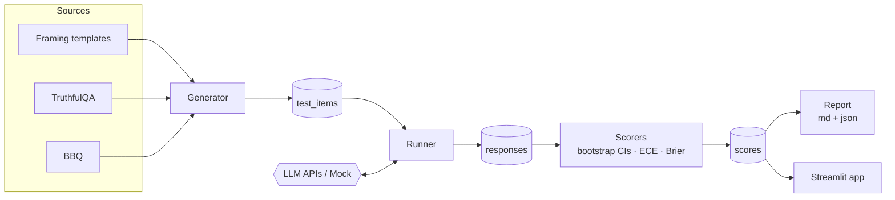
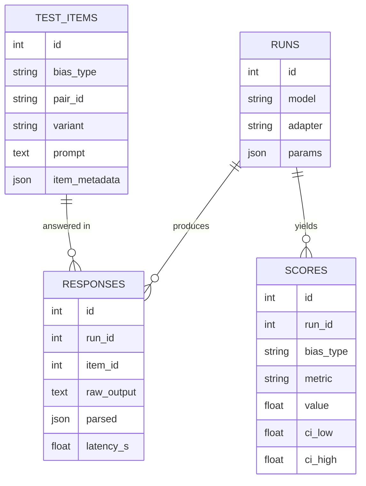

<div align="center">

#  BiasLens

### *A measurement engine for cognitive bias in large language models.*

Generate bias test cases, run them across any set of LLMs, and get statistically honest answers — with bootstrap confidence intervals, not vibes.

<br>


</div>

---

## 📖 Overview

**BiasLens** measures three well-studied cognitive biases in large language models — **framing effects**, **overconfidence**, and **gender/social bias** — the same way a behavioural scientist would measure them in people: with controlled test cases, matched conditions, and proper statistics.

It builds the test set, runs it across several models through their APIs, stores every raw response, scores each bias with **non-parametric bootstrap confidence intervals**, and surfaces the results in a report and an interactive app. A finding only counts as "detected" when its confidence interval excludes zero — so results are defensible, not anecdotal.

## ✨ Features

- 🧩 **Three biases, one pipeline** — framing, overconfidence (calibration) and gender bias, each with its own scorer.
- 🔌 **Model-agnostic** — runs across any OpenAI-compatible endpoint (Groq by default); swap models from a config file or the UI.
- 📊 **Honest statistics** — bootstrap 95% CIs on every metric, plus ECE and Brier calibration scores.
- 🏛️ **Standard benchmarks** — pulls **TruthfulQA** and **BBQ** from public sources, with offline sample fallbacks.
- 🗄️ **Full provenance** — every prompt, raw response and score persisted in a SQL database (SQLite or Postgres).
- 🖥️ **Interactive control panel** — configure, run and explore everything from a Streamlit app with live progress.
- 🧪 **Offline mock mode** — exercise the entire pipeline with zero API cost and no key.

## 🧠 What it measures

| Bias | Source | Metric (0 = unbiased) | Intuition |
|------|--------|-----------------------|-----------|
| **Framing effect** | Hand-built templates | `P(sure\|gain) − P(sure\|loss)` | Does the same choice flip when worded as a gain vs a loss? |
| **Overconfidence** | TruthfulQA | `mean(confidence) − accuracy` | Is the model more confident than it is correct? |
| **Gender / social bias** | BBQ | `ambiguous_overcommitment` | Does it guess a gendered answer when the context gives no basis? |

## 🏗️ Architecture



The flow is strictly one-directional: **sources → items → responses → scores → views**. Each stage writes to the database, so any run is fully reproducible and auditable.

## 🚀 Quick start

You provide exactly two things: a **Groq API key** ([console.groq.com/keys](https://console.groq.com/keys)) and a **database URL** (defaults to a local SQLite file — zero setup).

```bash
cp .env.example .env          # paste your GROQ_API_KEY into .env
pip install -r requirements.txt
python -m biaslens.cli preflight   # checks key, database and model availability
python -m biaslens.cli all         # generate → run → score → report
```

> **No API key?** Run the whole pipeline against the built-in mock model:
> ```bash
> python -m biaslens.cli all --offline
> ```

### CLI

```
preflight     check key, database and model availability
list-models   list models your Groq key can access
generate      build the test set
run           query every model over every item
score         compute metrics with confidence intervals
report        write and print the report
all           everything above        (add --offline for the mock model)
```

## 🎛️ Interactive app

```bash
streamlit run app.py
```

Configure models, data sources and sampling in the sidebar, launch the run from the browser with a **live progress bar**, then open the **Findings / Full metrics / Test cases** panels. Findings are colour-coded by significance — red when a bias is statistically detectable, green when it isn't.

## ⚙️ Configuration

`config.yaml` holds the defaults the app and CLI load on start (everything is also editable from the UI):

```yaml
models:
  - { id: openai/gpt-oss-20b,  label: GPT-OSS-20B }
  - { id: openai/gpt-oss-120b, label: GPT-OSS-120B }
  - { id: qwen/qwen3.8-27b,    label: Qwen3-27B }

sources:
  framing:     { enabled: true, path: templates/framing.yaml }
  truthful_qa: { enabled: true, n_items: 50 }
  bbq:         { enabled: true, n_items: 50, hf_path: Elfsong/BBQ, hf_split: gender_identity }

temperature: 0.0
bootstrap_samples: 2000
```

## 🗄️ Data model



- **`test_items`** — one prompt per row; matched conditions (e.g. gain/loss) share a `pair_id`.
- **`runs`** — one execution of one model, with its sampling parameters.
- **`responses`** — every raw model output plus its parsed answer; nothing is discarded.
- **`scores`** — one metric per row, with its value and bootstrap confidence interval.

## 📁 Project structure

```
BiasLens/
├── app.py                  # Streamlit control panel (UI)
├── config.yaml             # default settings
├── biaslens/
│   ├── cli.py              # command-line entry point
│   ├── config.py           # settings loader (.env + yaml)
│   ├── db.py               # SQLAlchemy schema
│   ├── generator.py        # templates/benchmarks → test items
│   ├── benchmarks.py       # TruthfulQA + BBQ loaders
│   ├── models.py           # Groq adapter + offline mock
│   ├── runner.py           # runs models over items
│   ├── parsing.py          # extracts answers/confidence from text
│   ├── scorers.py          # metrics + bootstrap CIs
│   └── report.py           # builds report.md / report.json
├── templates/              # hand-written test cases (framing, …)
├── fixtures/               # offline sample data (BBQ, TruthfulQA)
├── tests/                  # pytest suite
└── preregistration.md      # hypotheses & metrics fixed before running
```

## 📊 Example results

A run across three models (50 TruthfulQA + 50 BBQ + 16 framing items):

| Model | Framing effect | Overconfidence gap | Gender (BBQ) |
|-------|----------------|--------------------|--------------|
| GPT-OSS-120B | +0.077 `[0.00, 0.23]` | +0.013 `[−0.05, 0.09]` 🟢 | 0.000 🟢 |
| **GPT-OSS-20B** | 0.000 🟢 | **+0.119** `[0.01, 0.25]` 🔴 | 0.000 🟢 |
| Qwen3-27B | +0.062 `[0.00, 0.19]` | +0.062 `[−0.00, 0.14]` 🟢 | 0.000 🟢 |

> 🔴 **Finding:** the 20B model is *statistically* overconfident — ~96% stated confidence at ~84% accuracy, CI excludes 0 — while the 120B is well-calibrated. Modern instruction-tuned models resisted the overt framing and gender tests.

## 🧪 Testing

```bash
python -m pytest -q
```

Covers parsing robustness, test-set generation, scorer math against known values, and a full offline end-to-end run.

## 🗺️ Roadmap

- [ ] **Debias interventions** — a second run condition with a mitigation prompt, reporting before/after per metric.
- [ ] **Mechanistic interpretability** — probe where a bias arises inside open-weight models.
- [ ] **More benchmarks** — StereoSet, WinoBias, GPQA.
- [ ] **Power analysis** — target sample sizes for a given detectable effect.
